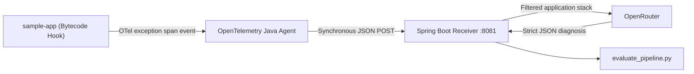

# Autonomous Exception Triage

**Authors:** Bishnu Prasad Mangaraj (23BCE0313) and Tanishq Pandey (23BCE0255)  
**Institution:** VIT

Three-module Maven project implementing an OpenTelemetry exception transport, Spring Boot telemetry receiver, stack-frame filtering, OpenRouter LLM reasoning, and a 30-case empirical evaluator.

## Architecture


## Build
```bash
mvn clean package
```

## Run receiver after setting your llm api key for personal preferences update the application.properties file according to your needs
```bash

cd receiver && mvn spring-boot:run
```

## Run sample app
```bash
cd sample-app && mvn spring-boot:run
```

## Agent extension
Place a compatible OpenTelemetry Java agent JAR at `otel-extension/lib/opentelemetry-javaagent.jar`, then:
```bash
java -javaagent:otel-extension/lib/opentelemetry-javaagent.jar \
  -Dotel.javaagent.extensions=otel-extension/target/otel-extension-1.0.0.jar \
  -jar sample-app/target/sample-app-1.0.0.jar
```

Optional:
```bash
export OTEL_TRIAGE_RECEIVER_URL=http://localhost:8081/api/telemetry/events
export OPENROUTER_MODEL=qwen/qwen-2.5-coder-32b-instruct
```

## Endpoints
`/api/orders/null-pointer`, `/api/orders/duplicate-key`, `/api/orders/shipped`, `/api/orders/empty-items`, `/api/orders/timeout`

## Evaluation
```bash
python3 evaluate_pipeline.py --mock
python3 evaluate_pipeline.py --live
```
Mock mode reproduces the requested research-paper assumption of 28/30 correct line localizations and 5.8 s average latency. Live mode uses actual receiver diagnoses.
